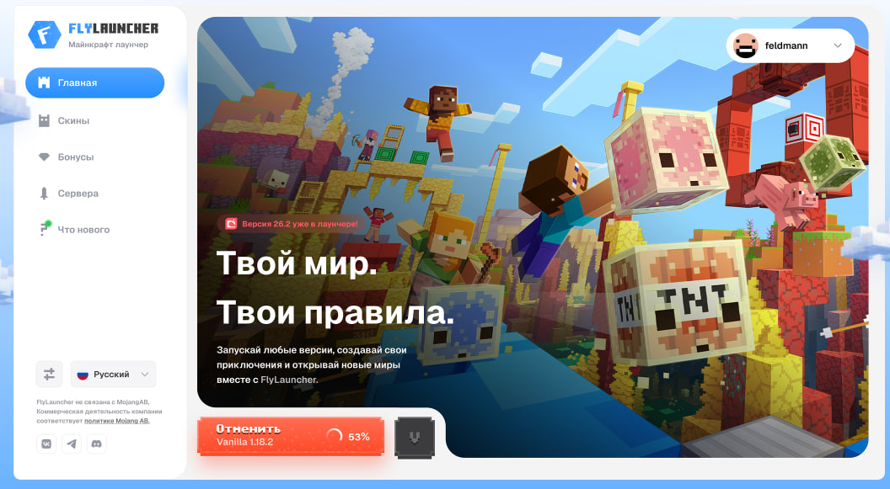
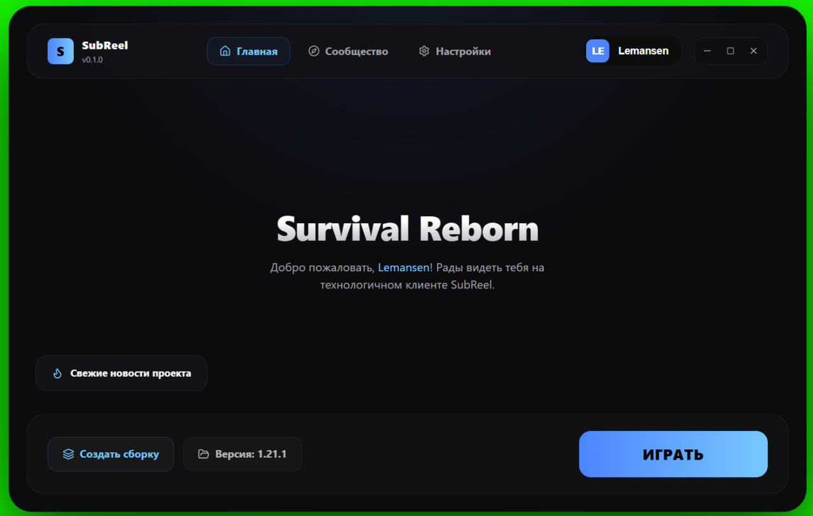

# Единый план разработки SubReel Launcher

Дата сверки: 27.10.2026. Этот документ объединяет исходные требования, аудит кода и фактически сообщённые результаты ручных проверок. Он заменяет параллельные списки этапов и служит основным планом дальнейшей работы.

## Принципы и область проекта

- WPF на .NET 10 остаётся тонким UI-слоем на MVVM. Игровая логика находится за контрактами в `Abstractions/Core/Infrastructure`; WPF не зависит напрямую от CmlLib.
- CmlLib.Core используется для Minecraft-версий и запуска за интерфейсом `IGameService`. Собственный загрузчик пишется только если конкретный сценарий нельзя надёжно покрыть библиотекой.
- Локальные сборки/инстансы и их настройки — единая сущность. Главная запускает выбранный инстанс, а не отдельную общую папку игры.
- Для Auth, профиля, новостей и серверных функций используем существующую SubReel Platform/Supabase. Отдельный ASP.NET backend без выявленной необходимости не создаём.
- Модули сначала остаются отдельными проектами в решении. Подключаемые сторонние DLL-плагины и отдельные `AssemblyLoadContext` добавляются после стабилизации контрактов.
- Критерий готовности — проверенный пользовательский сценарий и корректная обработка ошибок, а не наличие класса или экрана.

## Визуальные ориентиры, присланные 25.10.2026

Оба изображения включены в требования этапа 7, а не считаются уже реализованным экраном.

- **Первый скриншот FlyLauncher** — референс композиции: светлая узкая боковая навигация, большая hero-карточка с игровым артом, краткий текст, профиль сверху справа и кнопка запуска/прогресса у нижнего края. Перенимаем только композиционные идеи; логотип, арт, бренд и уникальные элементы FlyLauncher не копируем.
- **Второй скриншот SubReel** — референс собственного оформления: тёмное окно с округлённой рамкой, брендовая верхняя панель, вкладки, аккаунт, приветствие, новостной бейдж и нижняя панель действий. Это макет-направление, а не скрин текущей реализации.
- **Итоговый экран SubReel** — объединить функциональную композицию первого изображения с палитрой и брендингом второго: слева подписанная навигация; справа крупный hero с разрешённым артом, градиентом/затемнением и текстом; сверху профиль и системные кнопки окна; снизу в закреплённой зоне — выбранная сборка/версия, настройки сборки и широкая кнопка «Играть».
- Во время загрузки та же кнопка превращается в прогресс с процентом и действием «Отменить»; отдельный индикатор в Shell сохраняет видимость процесса при переходе на другую страницу. Акцентный цвет кнопки берётся из темы/сборки.
- Окно должно сохранять читаемость при изменении размера: навигация не перекрывает контент, hero масштабируется, нижняя панель остаётся доступной, текст и элементы не обрезаются. На меньшей ширине допускается компактная боковая панель, но не потеря пунктов навигации и запуска.

## Сводный статус

| № | Этап | Статус на дату сверки | Остаток / критерий завершения |
|---|---|---|---|
| 1 | Архитектура и фундамент | Основы DI, путей, модулей, сериализованных настроек и безопасного JSON recovery реализованы | Ручно проверить повреждённые файлы/резервные копии, гонки обновления настроек, запуск при ошибке Host и отсутствие секретов в логах; аудит границ модулей. |
| 2 | Игровое ядро и сессии | Общий `ILaunchOrchestrator`, типизированные этапы, процессное наблюдение, отмена и глобальный статус реализованы | На реальном запуске проверить отмену загрузки/старта, двойное нажатие, переходы страниц и аварийный отчёт. |
| 3 | Сборки и инстансы | CRUD, поиск/сортировка, изоляция путей, чистое дублирование, импорт/экспорт и восстановление выбора реализованы | Вручную проверить выбор после перезапуска, экспорт и оба варианта удаления; повторно подтвердить независимость каталогов. |
| 4 | Главный экран и навигация | Shell, зарегистрированные разделы, системные кнопки, выбор последней сборки, запуск и общий прогресс связаны; Community-пункта в текущих built-in modules нет | Довести hero-композицию по присланному референсу; проверить на чистом профиле, узком размере/DPI, офлайн и со сменой страниц во время запуска; определить и зарегистрировать Community после готовности этапа 10. |
| 5 | Версии Minecraft и загрузчики | Кэш/offline fallback, версии, Java inspection, Vanilla/Fabric/Forge/NeoForge/Quilt при создании и редактировании реализованы | Закрыть ручную матрицу старых/новых версий, загрузчиков, Java и offline cache, включая ранее проверенные 26.3 и 1.16.5. |
| 6 | Каталог и модпаки | Modrinth/CurseForge, защищённая установка, статусы/обновления, переводческий кэш, импорт/экспорт и очистка незавершённой установки реализованы | Проверить живые API, истёкшую сессию, отмену/повтор, вредоносный архив и импорт; обновление пакета сейчас ставится отдельным инстансом, in-place update не завершён. |
| 7 | Дизайн-система и анимации | Общие токены, иконки, reduced-motion, адаптивные карточки/формы, масштаб текста и доступность реализованы частично | Сверить готовый экран с обоими визуальными ориентирами; проверить реальные размеры/DPI, контраст, клавиатуру, обрезание и производительность. |
| 8 | Аккаунты и профиль | Microsoft-профиль и Supabase handoff с PKCE/loopback/DPAPI реализованы; серверная логика и миграции добавлены | Развернуть production encryption key и проверить одноразовый/истёкший handoff, refresh, повторный вход, unlink и изоляцию нескольких аккаунтов. |
| 9 | Интеграция с SubReel Platform | Новости, changelog, health endpoint, переводы, игровые профили/RLS и API релизов подключены; миграции применены | Опубликовать реальный релиз/новость и провести end-to-end проверки сайта, launcher, Supabase Auth и профилей A/B. |
| 10 | Сообщество и дополнительные функции | В лаунчере не зарегистрирован Community-модуль/пункт навигации; чат и backend-поведение не реализованы | Сначала согласовать серверные правила хранения/модерации/лимитов; затем добавить страницу и ephemeral chat, online list, жалобы и reconnect. |
| 11 | Настройки и диагностика | Java/RAM, локализация RU/EN, темы/motion, Platform health, логи и диагностический архив реализованы частично | Добавить/решить JVM args, прокси/зеркала/потоки, безопасный reset; вручную проверить RAM/Java, смену языка во всех окнах и redaction архива. |
| 12 | Тестирование и выпуск | WPF Debug build и ряд ручных запусков выполнялись; есть `VelopackUpdateService` | Нет завершённого unit-test/CI/release процесса: добавить тесты и GitHub Actions, настроить Release feed/GitHub/Velopack, проверить чистую установку, обновление, rollback и uninstall. |

## Этапы и критерии приёмки

### Этап 1. Архитектура и фундамент

**Подэтапы**

1. Зафиксировать границы слоёв: контракты в Abstractions, правила/модели в Core, файловые и сетевые адаптеры в Infrastructure/Auth, WPF только в App.
2. Проверить `Host`, регистрацию модулей и зависимостей; убрать сервисную/игровую логику из code-behind и исключить регистрацию одного сервиса несколькими несовместимыми способами.
3. Свести пользовательские пути, конфигурацию и логи в `IAppPaths`; разделить конфигурацию поставки и пользовательские настройки.
4. Защитить запись JSON атомарной заменой файла; при ошибке чтения сохранить повреждённый оригинал, создать резервную копию и сообщить о восстановлении.
5. Добавить версию схемы и последовательные миграции настроек/инстансов; не менять формат молча.
6. Централизовать обработку ошибок UI, фоновых задач и процесса; логировать тип операции, не записывать пароли, OAuth-коды, access/refresh-токены.
7. Устранить конкурирующее «прочитал → изменил → записал» в настройках: единый сервис обновления/сериализация операций.
8. Описать регистрацию и жизненный цикл `ILauncherModule`; DLL-плагины и динамическая загрузка пока не внедрять.

**Проверка:** чистый профиль → первый запуск → изменение настроек/сборок → перезапуск; искусственно испорченный JSON → сохранность исходника и восстановление; одновременные обновления разных настроек; разбор лога на отсутствие секретов.

**Готово, когда:** выполнены проверки выше; DI и структура понятны, данные восстанавливаемы, а сбой одного фонового запроса не завершает приложение.

**Уже сделано в начале этапа:** добавлен `ISettingsService.UpdateAsync`, изменяемые настройки в ViewModel переведены на read-modify-write под одним семафором; настройки мигрируются из legacy JSON без номера схемы в схему 1, неизвестная будущая схема не перезаписывается; повреждённые `settings.json`, `instances.json`, Supabase DPAPI-сессия и DPAPI-ключ переводчика сохраняются в резервных `.corrupt-*` вместо тихого удаления/перезаписи; запись сессии и ключа переводчика атомарна, открытый ключ очищается из памяти; при старте проверяются пустые/повторяющиеся ID модулей и страниц; DI проверяет области времени жизни и конструкторы сервисов на этапе построения Host; сервис новостей получает `HttpClient` через DI-фабрику; удалены пустые шаблонные `Class1.cs` и ссылка на несуществующую папку проекта. Восемь успешных сборок решения командой `dotnet build SubReel.Launcher.slnx --no-restore -m:1` завершились 25.10.2026 без предупреждений и ошибок. Для инстансов зафиксирована совместимая политика: пока `instances.json` остаётся JSON-массивом; при будущем переходе к конверту с номером схемы чтение сначала поддержит оба формата, миграция создаст резервную копию исходника и только затем атомарно заменит файл. На чтении пустые и повторяющиеся ID пропускаются с предупреждением, исходник остаётся нетронутым. Сохранение сперва проверяет каталог инстанса и записывает его манифест, затем обновляет каталог; некорректный путь не может создать запись-сироту.

Это ещё не закрывает этап: остаётся ручная проверка восстановления/миграции на копиях пользовательских данных и проверка поведения приложения при неудачной сборке Host.

### Этап 2. Игровое ядро и сессии

**Подэтапы**

1. Проверить текущие интерфейсы CmlLib-адаптера; все действия установки/запуска проводить через `IGameService` и Core orchestration.
2. Ввести типизированные `LaunchStage`/`LaunchProgress` (этап, доля/объём, сообщение/ключ локализации); убрать вывод состояния из анализа русскоязычной строки.
3. Свести запуск с Главной и страницы инстансов к одному `ILaunchOrchestrator`/менеджеру с singleton-состоянием процесса.
4. Состояния: Idle, Preparing, Downloading, Starting, Running, Exited, Crashed, Canceled, Failed; определённые переходы и терминальные ошибки.
5. Протянуть `CancellationToken` от UI до загрузки/установки; отмена освобождает ресурсы и не оставляет инстанс ложно «запущенным».
6. Защитить повторный старт того же экземпляра и определить поведение при уже работающей игре.
7. Наблюдать за `Process`: PID/время запуска, штатное завершение, код выхода, аварийное завершение; связать диагностическую информацию с конкретным инстансом.
8. Сделать единый поток событий для Shell, чтобы прогресс/играющий статус отображались на любой вкладке.

**Проверка:** установка с прогрессом, отмена во время скачивания, двойное нажатие «Играть», переход между страницами, штатное закрытие игры и аварийный выход.

**Готово, когда:** любой экран запускает только через общий сервис, UI не теряет состояние, повторный запуск предотвращён, исключения и отмена не повреждают инстанс.

**Уже выполнено:** запуск с Главной переведён с прямого вызова `IGameService` на `ILaunchOrchestrator`, как на странице инстансов; `GameInstallProgress` теперь содержит `GameInstallStage` и отдельное сообщение, поэтому Core больше не определяет стадию поиском русских слов. Сборка решения прошла без предупреждений и ошибок. Также добавлены активные состояния запусков по ID инстанса: повторный запуск той же сборки отклоняется, процесс наблюдается до выхода, а общий статус игр отображается в строке Shell на любой странице. Проверка завершения различает штатный выход и ненулевой код. Общий статус теперь отражает состояния Preparing, InstallingLoader, Downloading, Starting и Running; стадии прогресса обновляются синхронно внутри оркестратора, а UI получает уведомления через свой dispatcher. Ошибка подписчика статуса журналируется отдельно и не прерывает запуск или наблюдение процесса. Shell показывает итог завершения, отмены или ошибки на всех страницах; после короткого уведомления возвращает статус активной игры или раздела. Ошибка записи LastPlayedAt после успешного старта логируется отдельно и не маскирует запущенный процесс. Отмена до запуска завершает статусом Canceled; после возврата уже запущенного процесса оркестратор не использует токен отмены для сохранения метаданных, чтобы не сообщить ложную отмену. CmlLib-адаптер теперь возвращает код выхода и последний crash-report через контракт `IGameService`; оркестратор включает имя отчёта в статус, Shell показывает путь после аварийного завершения. При ошибке ожидания окна или отмене адаптер завершает дерево процесса, дожидается выхода Java и освобождает объект `Process`; после обычного выхода оркестратор также освобождает `Process` в `finally`. Страницы Главная и Сборки игнорируют отложенные callback-и прогресса после отмены/завершения, чтобы поздно доставленное обновление не затёрло итоговое сообщение об ошибке или отмене. Управление отменой перенесено в оркестратор: активную установку можно отменить из общей строки Shell после перехода на любую страницу; локальные кнопки Главной и Сборок продолжают использовать тот же связанный токен. Отмена доступна только до успешного запуска процесса, повторное нажатие безопасно, а ошибки callback-ов отмены логируются вместо выхода необработанного исключения в UI. Временная изолированная проверка на fake `IGameService` подтвердила, что параллельный запуск одного ID отклоняется, глобальная отмена переводит задачу в `Canceled`, а активная запись и маркер отмены очищаются. Этап 2 ещё не закрыт: остаётся ручная проверка отмены во время загрузки/старта и переходов между страницами в реальном приложении, проверка двойного нажатия в UI и сценарии штатного/аварийного завершения Minecraft. Поиск crash-report ограничен временем старта текущего Java-процесса с небольшим допуском на точность файловой системы, поэтому старый отчёт не будет выдан за новый. Установщики Fabric/Quilt в используемом API CmlLib не принимают `CancellationToken`; отмена распознаётся до и после такой установки, не оставляя фоновой операции, которая могла бы менять файлы после ответа UI.

### Этап 3. Сборки и инстансы

**Подэтапы**

1. Определить модель `LauncherInstance`: ID, имя, версия Minecraft, загрузчик/его версия, каталог, RAM/JVM overrides, дата создания/последней игры, обложка/иконка, источник и данные модпака при наличии.
2. Свести текущие записи к одной модели; добавить миграцию старых JSON и безопасные значения по умолчанию.
3. Репозиторий обеспечивает список/получение/создание/изменение/удаление и атомарное сохранение.
4. Мастер создания: имя и иконка → версия → загрузчик → RAM → подтверждение; на каждом шаге показывать допустимые варианты.
5. Форма редактирования отделяет общие настройки от параметров, которые требуют переустановки загрузчика.
6. Реализовать поиск/сортировку/избранное и состояния пустого списка.
7. Добавить дублирование с новым ID и новым игровым каталогом; копировать файлы только по ясной политике (полная копия либо чистая конфигурация).
8. Добавить «Открыть папку» и экспорт с манифестом состава.
9. Удаление: сначала убрать запись/состояние, спросить об удалении файлов; нормализовать путь и гарантировать нахождение внутри корня SubReel перед рекурсивной операцией.
10. Сохранять `LastPlayedInstanceId`; Главная использует именно него/выбранный экземпляр.

**Проверка:** CRUD нескольких инстансов, перезапуск, миграция старого файла, дубликат, экспорт, удаление с сохранением файлов и с удалением файлов.

**Готово, когда:** операции не затрагивают другие инстансы; каждый экземпляр запускается из своей папки и с собственными параметрами; старые записи мигрируют.

**Уже выполнено:** `LauncherSettings.LastPlayedInstanceId` записывается общим оркестратором при запуске с любого экрана. Главная при загрузке восстанавливает последний запущенный инстанс и показывает ComboBox сборок; выбор синхронизирует версию/загрузчик, а запуск использует RAM, Java и JVM-параметры инстанса. Старые версии добавляются в точный список, даже если их нет в текущей ленте. Если каталог загрузчиков недоступен, уже установленный загрузчик выбранной сборки сохраняется для запуска. Доступно «Дублировать как чистую сборку»: профильные настройки копируются, ID и папка игры новые, файлы игры не копируются; UI отдельно подтверждает эту политику. Список сборок поддерживает поиск по имени/версии/загрузчику, сортировку по имени/последнему запуску/избранному и отдельные состояния пустого списка и отсутствия совпадений. Для выбранного инстанса доступны открытие игровой папки и экспорт JSON-манифеста с настройками профиля и списком файлов `mods/` (относительный путь, размер, SHA-256); локальные пути Java/JVM и сами JAR не включаются. Экспорт JSON-манифеста теперь записывает файл во временный файл рядом с целевым и атомарно заменяет его только после полной сериализации. Удаление предлагает удалить только запись, удалить запись вместе с файлами либо отменить операцию. При удалении с файлами каталог сначала атомарно переносится во временную папку внутри корня инстансов, затем удаляется запись; при сбое репозитория файлы возвращаются на место. Незавершённая очистка повторяется при следующем старте и сохраняется, если запись инстанса всё ещё существует. Корень, путь игрового каталога и reparse-point для каталогов проверяются до файловых операций. Временная изолированная проверка подтвердила откат при ошибке репозитория, успешное удаление и отказ при пути за пределами папки инстанса. Сборка решения проходит без предупреждений и ошибок; ручные проверки выбора/перезапуска, экспорта и обоих вариантов удаления остаются открытыми.

Дополнительно: `InstanceService.GetValidatedGameDirectory` теперь проверяет, что путь соответствует ID самой сборки и находится внутри её каталога, а корень/каталог сборки/игровая папка не являются reparse-point. Эту проверку используют запуск через `ILaunchOrchestrator`, открытие папки и экспорт списка модов; `JsonInstanceRepository` также запрещает сохранить путь в каталоге чужого инстанса. Это защищает от старого или вручную испорченного `instances.json`, который раньше мог направить действие на произвольную папку. Сборка решения прошла без предупреждений и ошибок; ручной сценарий с изменённым `instances.json` пока не проверен.

### Этап 4. Главный экран и навигация

**Подэтапы**

1. Сверить навигацию/страницы из текущей реализации с целевым макетом; закрепить боковую навигацию: Главная, Сборки, Каталог, Сообщество, Новости, Настройки; профиль/аватар снизу.
2. Собрать Shell: бренд/версия, активный пункт меню, профиль и системные кнопки окна; исправить hit-testing и состояния minimize/maximize/close.
3. Hero загружает данные выбранной/рекомендованной сборки: арт, название, краткое описание и новостной/версионный бейдж. Fallback при отсутствии арта.
4. Нижняя закреплённая панель: «Создать/выбрать сборку», чип текущей версии и настроек, широкая primary-кнопка «Играть».
5. Связать действия с `LastPlayedInstanceId` и этапом 3; не запускать глобальную папку игры отдельно.
6. В состоянии установки основная кнопка показывает «Скачиваю N%» и «Отменить»; в состоянии Running меняется на «Игра запущена»/«Перейти к игре» согласно возможностям.
7. Навигация не уничтожает долгие операции; добавить `OnNavigatedTo/From` или эквивалент только там, где нужен lifecycle.
8. Новости на Главной — бейдж/короткий teaser, клик ведёт в новость; не подменять ими основные элементы запуска.
9. Учесть пустое состояние без сборки, офлайн, отсутствие аккаунта, процесс игры уже открыт, загрузку и ошибку.
10. Адаптировать Shell к изменению размера и масштабированию Windows; проверить доступность панели запуска.

**Проверка:** открыть проект на чистом профиле, создать сборку с Главной, запустить, отменить, уйти на другую вкладку и вернуться, повторно открыть приложение.

**Готово, когда:** экран следует второму макету SubReel по тёмному брендингу, а композиционно использует первый референс без копирования бренда FlyLauncher; запускается фактически выбранный инстанс.

### Этап 5. Версии Minecraft и загрузчики

**Подэтапы**

1. Использовать CmlLib как источник/исполнитель; его типы не протекать в ViewModel и модели сохранения.
2. Поддерживать манифест и кэш с датой обновления, явным обновлением, offline fallback и защитой от дублей.
3. Группировать версии (26, 1.21, 1.20 и т. д.) и показывать точные release/snapshot/прочие каналы с метками.
4. Ввести модель возможностей: какие загрузчики существуют для конкретной версии, их актуальные версии и причина недоступности.
5. Внедрить Vanilla, Fabric, Forge, NeoForge и Quilt в создание инстанса и его редактирование, а не только в отдельный экран.
6. Выбирать Java runtime по требованиям Minecraft/загрузчика; дать пользователю переопределение и проверить совместимость JVM.
7. Установить отображаемые статусы latest/snapshot и не приравнивать snapshot к стабильному релизу.
8. Проверить повторную установку, неполный кэш, отмену, сетевую ошибку и запуск уже установленного экземпляра.
9. Зафиксировать матрицу поддерживаемых версий и повторить ручную проверку 26.3, 1.16.5 и Quilt; расширить её Fabric/Forge/NeoForge.

**Проверка:** обновить список дважды без дублей; выбрать несовместимый загрузчик; установить и запустить каждую строку матрицы; проверить поведение без сети при наличии кэша.

**Готово, когда:** селектор точно отражает доступные сочетания, CmlLib покрывает заявленную матрицу, а ошибки объяснимы и повторяемы.

**Уже выполнено:** официальный `version_manifest_v2.json` кэшируется атомарно на час и используется при сетевой ошибке. Кнопка «Обновить манифест» обходит свежий кэш и запрашивает актуальный список у Mojang; при недоступности сети корректный кэш остаётся fallback. Парсер удаляет повторы по ID и отклоняет пустой список даже в синтаксически корректном JSON. Главная показывает, когда используется свежий ответ, кэш или offline fallback, и время обновления манифеста. В каталоге загрузчиков отсутствие совместимой сборки теперь отделено от ошибки сети/метаданных; временная ошибка больше не кэшируется на час как постоянная недоступность. Главная показывает причины недоступности загрузчиков под списком вариантов, а не только во всплывающей подсказке. Оркестратор использует Java-путь инстанса, а если он не задан — глобальную настройку; при заданном, но отсутствующем файле Java запуск останавливается с понятной ошибкой до загрузки игры. В форме инстанса есть поле переопределения Java и команда инспекции: она запускает выбранный runtime с `-version`, распознаёт major-версию и ограничивает ожидание 8 секундами. Инспекция получает `javaVersion.majorVersion` из официальных метаданных Minecraft, проверяет SHA-1 загруженного JSON и кэширует его отдельно по версии игры; интерфейс сообщает, ниже ли Java необходимого минимума. При запуске явно заданная Java проверяется до установки файлов; если известное требование выше major-версии Java, запуск отклоняется с причиной. Ошибка загрузки метаданных требования логируется и не блокирует запуск. Мастер создания инстанса теперь предлагает Quilt; для всех не-Vanilla вариантов при пустом поле выбирается рекомендуемая совместимая версия из каталога, а при временном сбое каталога можно указать версию вручную. Сборка решения прошла без предупреждений и ошибок. Ручные проверки offline fallback, дублей, Java inspection, создания Quilt и матрицы загрузчиков остаются открытыми.

Для версий дополнительно добавлены отдельные переключаемые каналы `old_alpha` и `old_beta`; по умолчанию они скрыты, в настройке версий появляются только по выбору пользователя и отображаются со своими метками. При включении legacy-каналов группы не обрезаются фиксированным лимитом, поэтому старые версии остаются доступны в горизонтальном списке.

Редактор инстанса позволяет сменить Minecraft и загрузчик, включая Quilt. Если меняется версия игры или тип загрузчика, перед сохранением каталог проверяет совместимость и выбирает рекомендуемую версию; установка нового сочетания выполняется при следующем запуске, текущая игровая папка сохраняется.

### Этап 6. Каталог и управление модпаками

**Подэтапы**

1. Привести Modrinth/CurseForge к общей модели `ModpackSummary/Detail/Version/Provider`; сравнивать enum, не строку вроде `"curseforge"`.
2. Разделить каталог и установщик по интерфейсам провайдера; настройки API/прокси задавать окружением.
3. Сделать страницу каталога: поиск, фильтры Minecraft/loader, сортировка, пагинация/«Показать ещё», количество результатов и пустые состояния.
4. Карточка и детальная страница: иконка, автор, описание, загрузки, поддерживаемые версии, источник, ссылка на оригинал и установка.
5. Исправить корректность endpoint CurseForge proxy, авторизации/refresh Supabase и нормализацию ошибок; HTML от прокси не выводить как текст ошибки.
6. Установка создаёт новый изолированный инстанс, загружает список файлов с прогрессом, отменой и отчётом частичного успеха.
7. Проверять архивные пути, симлинки, дубли/размеры/пределы распаковки; запрещать выход за каталог инстанса.
8. Хранить манифест установленного пакета; показывать «Установлен»/«Есть обновление» и безопасно обновлять.
9. Добавить экспорт/импорт поддерживаемого формата и восстановление после прерванной установки.
10. Перевод описаний отделить от UI-локализации; кэшировать переводы, не просить каждого пользователя вводить ключ DeepL.

**Проверка:** анонимный и авторизованный запросы, валидные и истёкшие сессии, 401/403/404, недоступность прокси, установка/отмена/повтор, перезапуск и импорт тестового архива с traversal-путём.

**Готово, когда:** каталог не маскирует серверные ошибки, а установка и повторное открытие дают правильное состояние без риска для файлов.

**Уже выполнено:** Modrinth installer ограничивает размер загружаемого архива и общий фактически скачанный объём клиентских файлов, даже если сервер указал неверный `Content-Length` или `fileSize`. Незавершённая загрузка удаляется при ошибке, дублирующиеся пути и Windows alternate data stream пути отклоняются. CurseForge installer теперь ограничивает поток архива, размер каждого файла модификации и совокупный фактический объём модов с учётом распакованных overrides; размер каждого скачанного файла сверяется с метаданными. Рекурсивное распаковывание overrides уже проверяет общий фактический объём и предел 8 ГБ. Для новых установок в манифест инстанса записываются провайдер, ID и slug проекта, название и ID версии, версия Minecraft и загрузчик; каталог использует эти данные, сохраняя совместимость со старыми записями через поле `Source`. Провайдер представлен enum `ModpackProvider` в общей модели, а ветвление по строковым идентификаторам заменено сравнением типа. Карточка каталога и страница проекта показывают автора и источник из данных соответствующего провайдера; со страницы проекта можно перейти к оригиналу на Modrinth или CurseForge. Даты публикации версий загружаются обоими каталогами; индикатор обновления ставится на самую свежую по дате версию, с сохранением исходного порядка API при отсутствии дат. Экспорт JSON сохраняет метаданные, импорт проверяет исходную версию у провайдера и ставит её как новый инстанс; существующие сборки не перезаписываются. Установка помечает инстанс состоянием `Installing`, а после успешного заполнения файлов переводит в `Ready`; при следующем запуске лаунчер находит такие незавершённые инстансы и безопасно удаляет их вместе с отдельным каталогом игры, чтобы их можно было установить заново. Также удаляются оставшиеся временные каталоги архивов с ожидаемыми именами и только внутри кэша лаунчера. Переводы каталога кэшируются локально по SHA-256 текста и языка, атомарно записываются и ограничены 10 000 записями. Добавлен `POST /api/launcher/translate` в SubReel Platform: он требует Supabase-сессию, ограничивает размер текста и частоту запросов, а ключ DeepL остаётся только в серверном окружении. Лаунчер больше не просит вводить ключ в настройках; для новых переводов требуется вход в SubReel, кэшированные тексты доступны офлайн. Ранее установленные версии помечены, повторная установка той же версии отключена. Если у проекта установлена другая версия, самая свежая версия по дате публикации помечается как доступное обновление; выбор создаёт новый изолированный инстанс, исходная установка остаётся нетронутой. Сборка лаунчера прошла без предупреждений и ошибок; production endpoint и реальный перевод требуют серверного `DEEPL_AUTH_KEY` и ручной проверки.

### Этап 7. Дизайн-система и адаптивная компоновка

**Подэтапы**

1. Зафиксировать дизайн-токены: фон/панели/текст/границы/радиусы/отступы/типографика; фиолетовый/голубой брендовый акцент согласовать, акцент сборки может переопределять бренд в заданных пределах.
2. Перенести захардкоженные цвета в ResourceDictionary и заменить разрозненные hex; проверить корректность XAML-типов (например, `Color` у DropShadowEffect задаётся как `Color`, а не некорректный brush/string binding).
3. Сформировать набор компонент: кнопки, chips, карточки, поля, Toast, Dialog, EmptyState, Skeleton/Shimmer, RAM slider, progress-in-button.
4. Заменить Unicode-символы одним стилем векторных иконок; выбрать кириллически совместимый шрифт заголовков и проверить fallback.
5. Реализовать главный экран по двум присланным ориентирам (описание выше): shell/navigation, hero, версия/сборка, аккаунт, нижняя панель запуска, промежуточные состояния.
6. Для Главной: карточки семейств 26/1.21/1.20 и т. д.; по выбору показать точные версии и чипы Vanilla/Fabric/NeoForge/Forge/Quilt только там, где доступны. Раскрытие анимировать opacity/transform, не менять layout-ширины анимацией.
7. Добавить эффекты hover/parallax на карточки только при включённой анимации и наличии ресурсов; иметь статичный режим.
8. Раздел «Сборки» оформить компактно и функционально: табы Мои/CurseForge/Modrinth/Создать свою/От студий (последнее с «Скоро» до API), поиск и фильтры.
9. Новости: крупная свежая карточка, сетка обложек, дата/тег/новое, читатель с плавным переходом.
10. Оформить профайл, каталог, настройки и ошибки теми же компонентами; убрать дублирующие панели и строку текущего раздела, если она присутствует.
11. Проверить целевые размеры окна, DPI/scaling, tab-navigation, фокус, контраст и reduced-motion.
12. Использовать собственный/лицензированный арт; при `art: null` показывать согласованный тематический fallback, большие blur не вычислять на лету.

**Проверка:** снимки Главной/Сборок/Каталога/Новостей при нескольких ширинах и DPI; проверка reduced-motion; навигация клавиатурой и масштаб текста.

**Готово, когда:** визуальная композиция соответствует макету SubReel, приложение адаптивно, изображения и тексты не обрезаются, а эффекты не мешают запуску и производительности.

**Уже выполнено:** сетка карточек каталога использует `ResponsiveTilePanel`: карточки формируют несколько колонок на широком окне и сжимаются до доступной ширины на узком; высота строк выравнивается, интервалы задаются параметрами панели. Фильтры каталога используют ту же панель, поэтому при сужении окна перестраиваются с четырёх колонок в две и затем в одну, без фиксированных ширин полей. Страница проекта располагает описание и список версий рядом на широком окне и складывает их вертикально на узком; сообщения о совместимости в мастере создания сборки переносятся по словам. Нижняя панель каталога переносит длинный статус и кнопки на отдельные строки. Лента новостей использует ту же адаптивную сетку карточек вместо фиксированной ширины; на узком окне карточки занимают доступную ширину. Главный анонс новостей при ширине меньше 620 DIP переносит номер версии над текстом и уменьшает его размер; на широком экране сохраняет двухколоночную композицию. Метаданные статьи и кнопка GitHub в читалке переносятся по ширине; переход между лентой и читалкой учитывает Full/Reduced/Off. В детальном экране версии список точных версий и выбор загрузчика складываются в одну колонку с вертикальной прокруткой на узком окне; статус и запуск игры также перестраиваются из двух колонок в одну. Карточки семейств, список версий и чипы загрузчиков на главной показывают видимое состояние клавиатурного фокуса. Hover-подъём карточек главного экрана переведён на общий `MotionBehaviors.HoverLift`: режим Reduced сокращает длительность эффекта вдвое, Off сбрасывает трансформацию без анимации. Переход главной между лентой версий и экраном выбранной версии тоже теперь следует режимам Full/Reduced/Off. Кнопки обновления в настройках переносятся на следующую строку, если не помещаются рядом. На странице игровых сборок поиск и сортировка перестраиваются в две строки при ширине списка меньше 520 DIP; основной редактор уже переходит под список при ширине страницы меньше 760 DIP. Элементы списка сборок получили имена для средств доступности и явный клавиатурный фокус у команды избранного. Дизайн-токены BodyFont и DisplayFont теперь применяются к текстовым блокам и основным заголовкам экранов; для текста используется Segoe UI с кириллическим fallback Windows. Проверка фактического отображения на разных размерах окна и DPI остаётся открытой.

Общая палитра теперь задаёт цвет текста на акцентном фоне отдельным `AccentTextBrush`; экран запуска и окно аккаунта используют общие ресурсы для фона, поверхности, рамки и основного/вторичного текста. Повторяющиеся hex-значения для текста на акцентных кнопках вынесены из главной, новостей и общих стилей в этот токен. Параметры форм и кнопок согласованы с ресурсами темы; визуальная проверка экранов остаётся открытой.

Векторные геометрии централизованы в `Resources/Themes/Icons.xaml`. Навигационные модули передают семантические имена значков, а `IconGeometryConverter` отображает их геометрией; для старых модулей сохранена совместимость с прежними символьными ключами. Кнопки окна, поиск, обновление новостей, избранное и индикаторы запуска/лицензии переведены на `Path`, поэтому отображение не зависит от глифов выбранного шрифта.

Добавлен пользовательский масштаб текста 85/90/100/110/125% с сохранением в `LauncherSettings`, применением сразу во всех окнах и ограничением допустимого диапазона при чтении файла настроек. Явные размеры текста в XAML и типографика стандартных контролов используют `ScaledFontSize`, поэтому после переключения не требуется перезапуск. Минимальный размер главного и аккаунтного окон снижен для небольших дисплеев; реальную проверку крайних разрешений и масштабов Windows надо выполнить на нескольких DPI.

Палитра окна авторизации и приветственной настройки переведена на общие ресурсы поверхностей, границ, текста и адаптивных акцентных оттенков. Добавлены полупрозрачные accent/success brushes, чтобы карточки и индикаторы сохраняли оттенок выбранной темы вместо отдельного зашитого фиолетового/зелёного набора.

Добавлен переиспользуемый `EmptyStateCard` с семантической векторной иконкой, заголовком и пояснением; он используется в списке сборок для пустого списка и отсутствия результатов поиска, а также в каталоге модпаков при пустом результате запроса. Окно диагностики переведено на ресурсы темы, ограничено минимальным практичным размером, а действия переносятся при уменьшении ширины.

Оставшиеся цвета shell, главной и новостной читательской панели заменены семантическими brush-токенами; добавлены токены контуров стеклянных панелей, приглушённого текста и текстового/затемняющего слоя поверх арта. Исключение — двухцветная подложка hero-карточки, которая намеренно задаёт контраст поверх иллюстрации.

Переходы между ViewModel больше не создают полноэкранный bitmap-снимок, если выбран режим `Off`; вместо этого они сразу показывают новый экран и сбрасывают возможные незавершённые opacity/transform-анимации. Снимок также создаётся только при наличии целевого элемента шаблона.

Создан переиспользуемый `MemoryAllocationControl` для форм создания/редактирования инстанса и мастера пользовательской сборки. Он единообразно задаёт диапазон 512 МБ–32 ГБ, шаг 512 МБ и доступное имя; числовые поля рядом оставлены для точного ввода. Проверка локальной сборки WPF прошла без предупреждений и ошибок. Проверка управления слайдером в запущенном интерфейсе остаётся частью визуального прогона этапа.

Приветственное окно и проверка перед запуском теперь допускают уменьшение до 420×520 и изменение размера; область проверок/первичной настройки прокручивается, а подписи настроек учитывают масштаб текста. Это снимает жёсткий минимум 520×650, который мог не помещаться на небольшом экране. Сборка WPF прошла без предупреждений и ошибок; проверка на реальном DPI и разрешении остаётся открытой.

В главной карточке новости снят фиксированный предел высоты описания: длинный текст и увеличенный пользовательский масштаб больше не обрезают сводку, карточка растёт по содержимому. Сборка WPF прошла без предупреждений и ошибок; визуальное сравнение на узком размере и при увеличенном тексте остаётся открытым.

Строки версий на странице модпака перестроены: название, версия и совместимость теперь занимают всю ширину, а кнопки действий идут отдельной строкой и переносятся при необходимости. Это сохраняет читаемость метаданных в одноколоночном режиме на узком окне. Сборка WPF прошла без предупреждений и ошибок; визуальная проверка на реальном размере окна остаётся открытой.

Общий стиль `ChipToggle` получил отдельный видимый контур клавиатурного фокуса с утолщением рамки, согласованный с акцентом темы. Это закрывает пропуск в собственном шаблоне ToggleButton, который не наследовал визуальное состояние стандартной кнопки. WPF-проект собрался без предупреждений и ошибок; ручной прогон клавиатурной навигации остаётся открытым.

Цвет токена `TextTertiary` повышен с `#666476` до `#8B90A5`: контраст на основных тёмных поверхностях стал не ниже 4.85:1 вместо прежних 2.67:1 на приподнятой карточке. Токен используется для подписи версии в боковой панели. Значения рассчитаны по формуле относительной яркости WCAG; сборка WPF прошла без предупреждений и ошибок.

В окне аккаунта вкладки переведены на общий пользовательский масштаб текста, а фиксированная высота текстовых полей, пароля и кнопок заменена минимальной. При увеличении шрифта элементы могут расти по содержимому, не теряя исходную минимальную высоту. Сборка WPF прошла без предупреждений и ошибок.

Кнопки Microsoft-входа, проверки лицензии, покупки игры и добавления офлайн-профиля в окне аккаунта заменили горизонтальную `StackPanel` на `WrapPanel`. При сужении окна или увеличении текста действия переносятся на следующую строку вместо выхода за границы. Сборка WPF прошла без предупреждений и ошибок; ручная проверка при минимальной ширине окна остаётся открытой.

Каскадное появление элементов списка теперь в режиме `Off` очищает активные анимации и показывает элементы сразу; режим `Reduced` уменьшает интервал каскада. Shimmer отключён для обоих доступных режимов снижения движения и показывает статичную заглушку вместо бесконечной пульсации.

Для иконок навигации, аккаунта, системных кнопок окна, карточек версий и новостей заданы имена/подсказки Automation; имя кнопки разворачивания меняется вместе с её действием при переходе в полноэкранный режим.

Лента новостей использует общий `EmptyStateCard`, пока публикации загружаются или когда после запроса результат пустой/недоступен; дублирующая строка состояния скрывается, когда пояснение уже показано в карточке.

Fallback-страница неизвестного/ещё не реализованного модуля больше не показывает отладочное сообщение «Компонент страницы подключён»: использует общий пустой компонент и векторную иконку зарегистрированного пункта навигации.

У описаний карточек каталога задан адаптивный диапазон высоты вместо жёстких 38 DIP, а фиксированная высота строки убрана из читалки новостей; масштабированный текст может занимать нужную ему высоту без обрезания по базовому размеру.

Карточки семейств Minecraft на главной подстраивают высоту под фактически видимую область горизонтальной карусели (с прежним верхним пределом 350 DIP), поэтому на небольшом окне не обрезаются вертикально.

Цвет текста главных карточек и кнопки проверки обновлений привязан к семантическим foreground-токенам темы; больше нет отдельных значений `White` для этих элементов.

При выборе семейства Minecraft общий цвет акцента теперь плавно переходит к цвету выбранной версии за 250 мс; при `Reduced` переход короче, при `Off` применяется сразу. Обновление центрального токена синхронно меняет связанные акцентные кисти во всём интерфейсе.

Прогресс запуска главной страницы теперь заливает фон кнопки «Играть» под её текстом, вместо отдельной тонкой полосы вдоль нижнего края.

### Этап 8. Аккаунты и профиль

**Подэтапы**

1. Разделить SubReel ID (платформенный аккаунт) и Microsoft/Minecraft аккаунт (игровая лицензия); UI ясно показывает их разные статусы.
2. Сайт `subreel-webminecraft` получает страницу входа/подтверждения и использует Supabase Auth; после входа показывает, какое приложение запрашивает доступ.
3. Реализовать handoff: случайные state/verifier, PKCE challenge, короткий срок действия, одноразовый код; сервер удостоверяет Supabase пользователя; URL callback содержит только код/state.
4. Loopback listener на `127.0.0.1` принимает callback только на временный порт; проверяет state, ограничивает размер запроса, отвечает простой страницей завершения.
5. Обмен кода/verifier проходит по HTTPS к серверному endpoint; защита от повторного использования и подбора; короткая запись хранится сервером с шифрованием и истечением срока.
6. Проверить профиль сайта перед выпуском code; разрешить только loopback redirect, не произвольный redirect URI.
7. Валидировать полученную Supabase-сессию запросом Auth API, сохранять локально через DPAPI, обновлять refresh с учётом одноразовости refresh token.
8. Поддержать Microsoft interactive login через CmlLib, восстановление его игровых учётных записей и статус лицензии Minecraft Java Services.
9. Привязка игрового UUID/имени к SubReel выполняется только после доказанной игровой сессии; игровые токены в Supabase не передаются.
10. Добавить управление аккаунтами: активный аккаунт, переключение, переавторизация, отвязка, выход и понятное состояние офлайн.
11. Ограничивать платформенные функции, которым нужна сессия, но не блокировать разрешённый локальный/офлайн запуск.

**Проверка:** вход/регистрация/подтверждение почты сайта; успешный callback; отказ; подменённый state; просроченный/повторный code; неверный verifier; перезапуск и refresh; Microsoft без Java и с лицензией; unlink/sign-out/re-login.

**Готово, когда:** вся передача токенов безопасна и протестирована; сайт и launcher используют один Supabase-проект; Microsoft лицензия проверяется независимо от Supabase Auth.

**Уже выполнено частично:** `/login` и `/auth/callback` принимают только безопасный внутренний `next`. На Platform реализована страница подтверждения launcher handoff, API start/status/approve/exchange, PKCE/state, одноразовое погашение кода и SQL миграция. В launcher добавлены системный браузер, loopback callback, проверка Supabase-сессии и DPAPI-хранение; окно сворачивается на время входа, чтобы не перекрывать браузер. Миграции 031/032 теперь сверены с существующей схемой и записаны в истории; обе handoff-функции работают под `service_role`, публичный доступ закрыт. Production `LAUNCHER_AUTH_ENCRYPTION_KEY` и сценарии успешного/повторного/истёкшего входа всё ещё требуют проверки.

### Этап 9. Интеграция с SubReel Platform

**Подэтапы**

1. Составить карту уже существующих таблиц/API/Edge Functions сайта и Platform, указать владельца данных и политики RLS; не создавать повторяющие таблицы без причины.
2. Вынести project URL, publishable key и публичные endpoint в конфигурацию окружений; приватные server/service-role keys хранятся только в server environment.
3. Согласовать DTO и версии API для Auth handoff, профиля, лицензии, новостей и каталога; общие ошибки нормализовать.
4. Подключить отображение/редактирование профиля сайта и связанного игрового профиля с учётом RLS и прав пользователя.
5. Подключить новости: обложка, дата, тип/тег, бейдж нового, список и читатель; локальный запуск не зависит от доступности новостей.
6. Связать релиз приложения и release notes: администратор публикует артефакт/версию на GitHub и соответствующую новость/changelog в платформе.
7. Перевести CurseForge proxy/catalog на стабильный endpoint и проверить статус с реальным launcher bearer; обновлять истекающую Supabase-сессию и не выводить токен/сырые секретные payload.
8. Подготовить локальную/dev/prod конфигурацию и health/diagnostic checks; production host website должен быть фактически задеплоен.
9. Проверить RLS на публичное чтение новостей и изоляцию пользовательских данных; запрещённые действия остаются запрещёнными сервером.

**Проверка:** аккаунт A/B (профиль каждого изолирован), анонимное чтение публичных новостей, expired token, недоступность сайта/API, неверная конфигурация и админская публикация тестового релиза.

**Готово, когда:** данные совпадают между лаунчером и сайтом; доступ применяется сервером; все endpoint окружения настроены, сайт развёрнут, а сбой платформы не мешает локальной игре.

**Уже выполнено частично:** новости проходят через публичный `GET /api/launcher/releases`; опубликованные записи доступны только по публичной SELECT-политике, черновики — администраторам `catalog_admin`. На сайте добавлены `/news` и `/news/[version]` с общей лентой и страницей changelog; ссылка на новости доступна в навигации. Администратор задаёт метку новости и необязательную HTTPS-обложку, сайт и лаунчер отображают их. Миграция 034 расширила общую схему; Supabase Storage остаётся закрытым и для обложек не используется. Лаунчер задаёт 15-секундный предел запроса новостей. RLS-политики игровых профилей ограничивают CRUD текущим `auth.uid()`. Миграции 030–034 применены; 033 оптимизирует release-политики по результатам Supabase Performance Advisor. Живой прогон публикации всё ещё нужен.

**Диагностика конфигурации:** добавлен `GET /api/launcher/health`, который возвращает только признаки наличия настроек функций, без значений и секретов. В лаунчере в «Настройки → Подключение SubReel Platform» добавлена ручная проверка с таймаутом 10 секунд и понятными сообщениями. Она не блокирует запуск Minecraft и не подтверждает доступность сторонних API: проверяются доступность маршрута и наличие конфигурации, а не внешние сервисы. Проверка production-лаунчером будет доступна после деплоя нового endpoint.

**Проверка production 2026-10-27:** до миграций `launcher_releases` отсутствовала в schema cache и сайт отвечал 503. После применения `030–033` сайт и Supabase REST отвечают HTTP 200 с `[]`: интеграция исправлена, записей релизов пока нет. Security Advisor не находит новых проблем релизной таблицы; оставшиеся сообщения относятся к намеренно закрытым handoff-таблицам и существующим функциям Platform. Дальше требуется опубликовать реальный GitHub Release/новость и выполнить end-to-end проверку handoff и профиля с двумя аккаунтами.

### Этап 10. Сообщество и дополнительные функции

**Подэтапы**

1. До UI определить с платформой правила чата: realtime транспорт/канал, guest/auth доступ, модерация, лимиты, блокировки и срок хранения.
2. Вход на Community подключает поток; выход/закрытие страницы отменяет подписку и очищает список сообщений (для ephemeral режима).
3. Указать «История не сохраняется» только если сервер реально не хранит сообщения; иначе честно показать срок/правила хранения.
4. Поддержать текстовые сообщения с ограничением длины, rate limit, подавлением повтора и безопасной обработкой разметки.
5. Показать online-лист с аватарами/именами только на основании разрешённых публичных данных.
6. Добавить жалобу/блокировку/модерацию только с backend проверками и обработкой подтверждения.
7. Сетевые reconnect/error/loading состояния не должны держать UI или влиять на Minecraft.
8. После чата отдельно спроектировать друзей/приглашения/игровые сессии; достижения и магазин только если соответствующие API и бизнес-правила готовы.

**Проверка:** подключение/выход, очистка сообщений, лимит частоты, длинный/невалидный текст, offline/reconnect, жалоба и разные пользователи.

**Готово, когда:** приватность и модерация соответствуют фактическому поведению backend, а временная лента не остаётся доступной после выхода.

### Этап 11. Настройки и диагностика

**Подэтапы**

1. Разделить настройки по разделам UI: Запуск, Соединение, Оформление, Язык, О лаунчере/диагностика.
2. Запуск: Java auto-detect/ручной путь, тест runtime, RAM slider с проверкой доступной памяти, JVM аргументы с validation, поведение после старта, рабочая папка.
3. Сборки: показать наследуемые настройки и overrides конкретного инстанса; не путать глобальную настройку Java с параметром профиля.
4. Соединение: прокси/зеркала/число потоков с безопасными пределами, проверка доступности endpoint, reset default.
5. Оформление: тема, бренд/акцент, reduced-motion, плотность/масштаб если требуется.
6. Локализация: ресурсные ключи для всех статичных строк и отображение выбранного языка; не использовать автоматический сетевой перевод как единственный перевод UI.
7. Диагностика: открыть папки логов/игры, проверить обновление, экспортировать архив выбранного инстанса и логи с редактированием токенов/личных данных.
8. Восстановление: безопасный reset пользовательских настроек с резервной копией; проверка свободного места и повреждённых локальных файлов.
9. Согласовать диагностические ошибки: короткое действие пользователю и подробная запись в журнале; не показывать HTML/stack trace в обычном уведомлении.

**Проверка:** неверная Java, RAM за пределами, аргумент с некорректным форматом, смена языка, reduced-motion, reset, экспорт и проверка архива на секреты.

**Готово, когда:** все настройки валидируются и сохраняются атомарно, язык меняет интерфейс, диагностический архив безопасен и помогает восстановить проблему.

**Уже добавлено частично:** в настройках появились RAM по умолчанию для новых сборок с Главной, общий путь Java с выбором файла и проверкой runtime; индивидуальные параметры инстанса сохраняют приоритет. Русский/английский язык выбирается единообразно и переключается во время работы. Локализованы оболочка и навигация, главная страница, настройки, сборки/экземпляры, каталог модпаков и мастер установки, новости, окно авторизации, приветственный экран, диагностика ошибок и подписи доступности у элементов управления памятью. В карточке сборки локализован префикс версии Minecraft. Проверка версии загрузчика и совместимости Java в инстансах также выводит локализованные статусы; статусы скачивания/распаковки модпака и обновления Quilt локализованы. Прогресс установки модпаков и ошибки проверки обновлений также получают локализованный текст; причины ошибок сохраняются для диагностики. Сообщения запуска в Главной и Инстансах формируются по типизированному этапу, а не по внутреннему тексту CmlLib/установщика. Дата обновления манифеста на Главной использует формат выбранного языка и переформатируется при переключении языка; подписи для неизвестной даты и текущего времени также локализованы. В каталоге модпаков локализованы подписи автора и количества загрузок в карточках и на странице проекта; они обновляются и при переключении языка. Форматируемые числа и статусы теперь используют культуру выбранного языка, независимо от региона Windows. Переводятся программно обновляемые статусы и метаданные новостей; перевод пользовательских новостей сайта и исходных ошибок внешних сервисов зависит от данных/API и пока не гарантирован. Оба словаря сейчас содержат по 536 ключей без дубликатов и пропусков; дополнительно сверены 353 статические ссылки из XAML/code-behind/ViewModel — отсутствующих ключей не найдено. XML-разбор и `git diff --check` прошли; `dotnet build src/SubReel.Launcher.App/SubReel.Launcher.App.csproj` завершился успешно: 0 ошибок и 0 предупреждений. Полный ручной проход интерфейса на русском и английском ещё не выполнен. Следующий подэтап локализации — пройти все страницы в обоих языках, найти оставшиеся статические строки и проверить переключение языка на открытых диалогах и асинхронных состояниях. Также есть проверка конфигурации SubReel Platform, создание ZIP-архива диагностики и кнопка открытия папки Logs. Архив содержит сведения о версиях Windows/.NET и не более четырёх последних логов лаунчера (до 5 МБ каждый); настройки, игровые данные и файлы аккаунтов исключены. Перед упаковкой фильтруются Bearer/JWT, поля токенов/паролей, email и пути `C:\Users\...`. Архив создаётся в локальной папке Logs. Требуется ручная проверка Java/RAM и содержимого архива с контрольными строками перед использованием для поддержки; экспорт логов пока нельзя считать полностью проверенным на все возможные форматы секретов.

### Этап 12. Тестирование и выпуск

**Подэтапы**

1. Добавить тестовый проект для моделей/миграций, путей инстанса, репозиториев, выбора загрузчика и переходов launch state.
2. Подменять сеть и CmlLib на тестовые адаптеры; не требовать реального Mojang/Microsoft/Supabase для unit-тестов.
3. Собирать проверку вручную: старые/новые Minecraft, Vanilla/Fabric/Forge/NeoForge/Quilt, cancel, process exit/crash.
4. Добавить GitHub Actions: restore, build Release, unit tests, анализ/форматирование если выбраны; секреты и публикация только в release workflow.
5. Зафиксировать semantic/versioning схему и подготовить Velopack feed/artifact layout, подпись пакетов если настроена.
6. Настроить GitHub Releases с корректным владельцем/репозиторием и changelog; не оставлять пустой `GitHubRepository`.
7. Проверить обновление установленного старого релиза до нового, сохранность JSON/инстансов/сессий и восстановление после прерывания.
8. Проверить чистую установку Windows, отсутствующие prerequisites, запуск, удаление и повторную установку.
9. Подготовить release checklist, rollback plan, release notes и перечень известных ограничений.
10. После публикации выполнить smoke-check скачанного артефакта, сайта и новостного объявления.

**Проверка:** чистый checkout CI; локальный Release build; установка старой версии → обновление → запуск сохранённого инстанса; rollback/repair/uninstall.

**Готово, когда:** любой пользователь может получить подписанный/проверяемый пакет, обновиться без потери данных, а релиз воспроизводим из CI.

## Очерёдность выполнения

1. Выполнить ручной прогон уже написанных этапов 2–5: отмена/повторный запуск, CRUD и каталоги инстансов, Java/offline cache и сочетания версий/загрузчиков.
2. Завершить production handoff этапа 8 и end-to-end проверки Platform этапа 9 после настройки ключа; отдельно проверить профили двумя аккаунтами.
3. Проверить на реальных ответах API этап 6: авторизацию/истечение сессии, ошибки прокси, отмену/повтор и безопасный импорт; решить судьбу обновления установленного пакета.
4. Закрыть практические проверки этапа 11: RAM/Java, локализация открытых окон, reset и диагностический архив с тестовыми секретами.
5. Сверить визуальный макет и размеры/DPI этапа 7; исправлять только обнаруженные обрезания, недоступность и проблемы производительности.
6. Этап 10 начинать после согласования серверных правил хранения, жалоб, rate limit и модерации.
7. По мере стабилизации добавлять тесты и CI этапа 12; перед публикацией завершить Release/Velopack, upgrade, rollback и uninstall проверки.

## Вне текущего MVP

Собственная реализация полного Minecraft downloader, отдельный ASP.NET сервер при уже имеющейся Supabase Platform, загрузка произвольных сторонних DLL-плагинов до стабилизации API, магазин/экономика без серверных правил, интеграции CurseForge/DeepL с секретами в клиенте. Эти задачи возвращаются в план только при подтверждённой необходимости.

## Правило обновления статуса

При завершении подэтапа в этом документе отмечаются результат, проверенный сценарий, команда сборки/проверки и ограничения. Ручной запуск, сообщённый пользователем, записывается как ручная проверка; он не заменяет автоматические тесты или проверку повторного запуска/восстановления.
